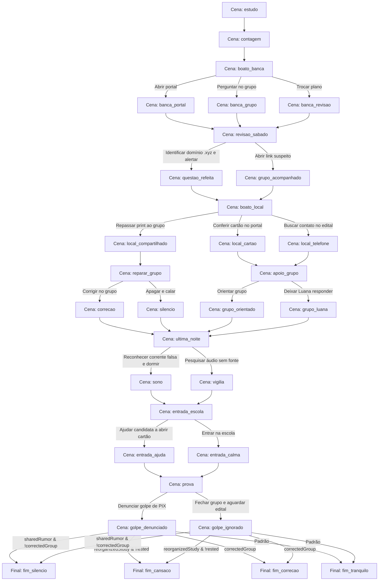

# Capítulo 1: Três anos de preparação

## Metadados do Capítulo
- **ID:** `chapter-01`
- **Número:** 1
- **Revisão:** 3
- **Título:** Três anos de preparação
- **Protagonista:** André (`andre`)
- **Contexto:** Um concurso fictício na reta final de uma preparação de três anos.
- **Cena Inicial:** `estudo`
- **Próximo Capítulo:** `chapter-02` (O que chegou ao grupo)

---

## Variáveis Iniciais de Estado
As variáveis controlam as ramificações e reações narrativas conforme as escolhas do jogador:
- `reorganizedStudy`: `false` (Indica se André mudou o plano de estudos por causa de boatos)
- `askedGroup`: `false` (Indica se André perguntou ao grupo sobre o comunicado oficial)
- `checkedCard`: `false` (Indica se André conferiu o próprio cartão de confirmação oficial)
- `calledOrganizer`: `false` (Indica se André tentou contato oficial listado no edital)
- `sharedRumor`: `false` (Indica se André repassou o boato/print para o grupo)
- `correctedGroup`: `false` (Indica se André enviou correção no grupo desmentindo o boato)
- `helpedGroup`: `false` (Indica se André enviou instruções oficiais para orientar o grupo)
- `rested`: `false` (Indica se André reconheceu a corrente falsa da madrugada e foi dormir)
- `practicedWeakPoint`: `false` (Indica se André identificou o domínio falso `.xyz` e alertou o grupo sobre o phishing de CPF)
- `followedGroup`: `false` (Indica se André clicou no link suspeito `.xyz` movido pela ansiedade)
- `helpedAtGate`: `false` (Indica se André ajudou uma candidata no portão a conferir o cartão no portal oficial)
- `settledAtGate`: `false` (Indica se André entrou diretamente na escola enquanto Luana orientava a candidata)
- `reportedScam`: `false` (Indica se André alertou o grupo e denunciou a montagem de golpe via PIX pós-prova)
- `ignoredScam`: `false` (Indica se André reconheceu o golpe pós-prova e fechou o grupo aguardando o canal oficial)

---

## Fluxo das Cenas

